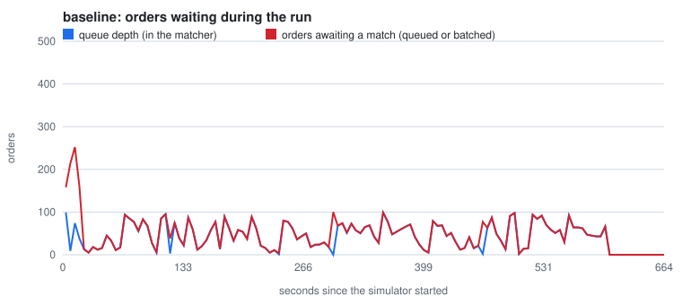
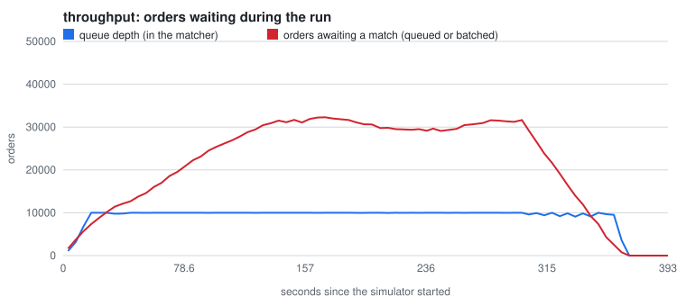
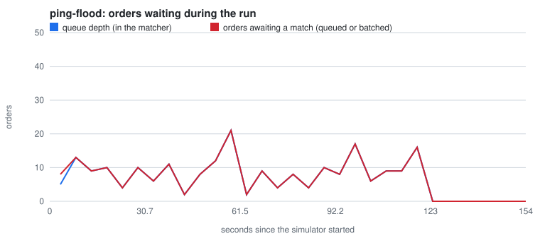
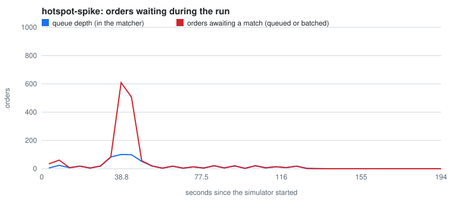
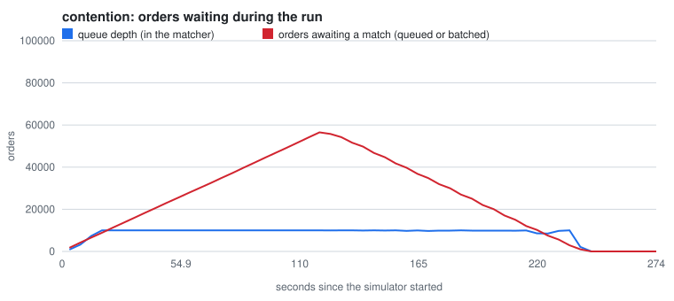
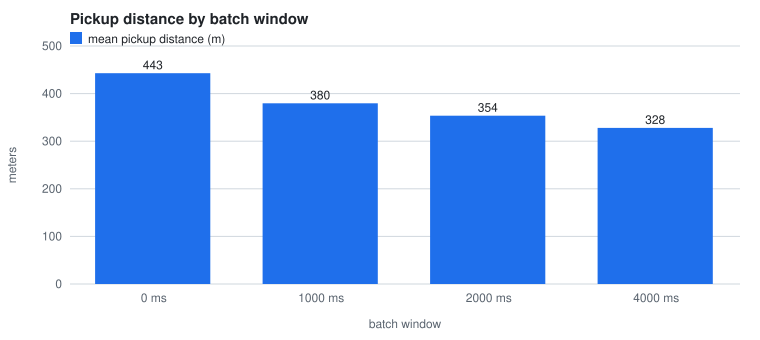
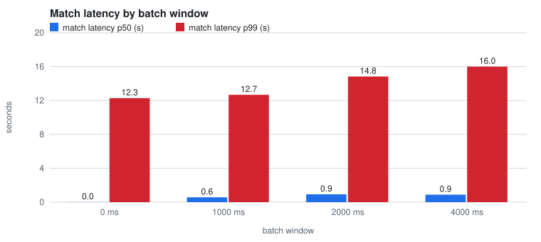

# Load test summary

Generated by `routebench summary` from the JSON files in this folder. Do not edit by hand.

**14 targets met, 3 missed.** Hardware: AMD Ryzen 7 5800H (8 cores, 16 threads); Docker Desktop VM with 16 CPUs and 8 GB RAM; the load generator, routed, Postgres, Redis and Redpanda all share this one machine

## baseline

1000 couriers, batch window 2000 ms. The simulator ran 660 s and created 29832 orders (29832 sent, 0 dropped by the client, 0 errors). Run started 2026-10-08 07:42 UTC.

| Target | Required | Measured | Result |
|---|---|---|---|
| match latency p99 | < 3 s | 5.15 s (p50 0.90 s) | **missed** |
| match rate | > 98% | 99.74% (29753 assigned, 79 exhausted, 0 still open) | met |
| pings shed | 0 | 0 | met |
| no double booking | 0 observed | 0 | met |

Match latency is order created to first offer sent: p50 0.90 s, p99 5.15 s, max 22.46 s. Mean pickup distance 256 m. Batches: 397, largest 100 orders, 0% solved greedily; batched pickup distance was 92.7% of the greedy baseline's. Peak queue depth 99.

## throughput

5000 couriers, batch window 2000 ms. The simulator ran 390 s and created 149597 orders (149597 sent, 0 dropped by the client, 0 errors). Run started 2026-10-08 07:55 UTC.

| Target | Required | Measured | Result |
|---|---|---|---|
| match latency p99 | < 4 s | 110.86 s (p50 25.33 s) | **missed** |
| match rate | > 95% | 75.99% (113678 assigned, 35919 exhausted, 0 still open) | **missed** |
| queue depth stable | last third of load <= 2x the middle third (or under 100) | thirds [9031, 9995, 9992], max 10005 | met |
| no double booking | 0 observed | 0 | met |

Match latency is order created to first offer sent: p50 25.33 s, p99 110.86 s, max 121.67 s. Mean pickup distance 297 m. Batches: 1660, largest 100 orders, 0% solved greedily; batched pickup distance was 92.3% of the greedy baseline's. Peak queue depth 10005.

## ping-flood

5000 couriers, batch window 2000 ms. The simulator ran 150 s and created 615 orders (615 sent, 0 dropped by the client, 0 errors). Run started 2026-10-08 08:03 UTC.

| Target | Required | Measured | Result |
|---|---|---|---|
| ping index lag p99 | < 1 s | 0.008 s | met |
| pings shed | acceptable, reported | 0 | reported |
| match latency p99 | < 3 s | 2.00 s (p50 0.99 s) | met |
| no double booking | 0 observed | 0 | met |

Match latency is order created to first offer sent: p50 0.99 s, p99 2.00 s, max 8.54 s. Mean pickup distance 63 m. Batches: 61, largest 22 orders, 0% solved greedily; batched pickup distance was 100.0% of the greedy baseline's. Peak queue depth 21.

## hotspot-spike

1000 couriers, batch window 2000 ms. The simulator ran 190 s and created 3204 orders (3204 sent, 0 dropped by the client, 0 errors). Run started 2026-10-08 08:06 UTC.

| Target | Required | Measured | Result |
|---|---|---|---|
| batch size cap holds | max batch <= 100 orders | 100 | met |
| queue drains after the spike | within 60 s | 19 s | met |
| surge reaches the maximum | 3.0x | 3.0x | met |
| no double booking | 0 observed | 0 | met |

Match latency is order created to first offer sent: p50 0.77 s, p99 11.57 s, max 15.17 s. Mean pickup distance 981 m. Batches: 162, largest 100 orders, 0% solved greedily; batched pickup distance was 98.8% of the greedy baseline's. Peak queue depth 101.

## contention

200 couriers, batch window 2000 ms. The simulator ran 270 s and created 60003 orders (60003 sent, 0 dropped by the client, 0 errors). Run started 2026-10-08 08:09 UTC.

| Target | Required | Measured | Result |
|---|---|---|---|
| exhausted orders | non-zero, reported honestly | 53870 of 60003 orders (89.8%) | met |
| claim conflicts | counted | 0 | reported |
| no double booking | 0 observed | 0 | met |

Match latency is order created to first offer sent: p50 62.99 s, p99 120.94 s, max 121.81 s. Mean pickup distance 499 m. Batches: 1471, largest 100 orders, 0% solved greedily; batched pickup distance was 98.8% of the greedy baseline's. Peak queue depth 10000.

## solver-comparison

The baseline load, shortened to 2 minutes, run once per batch window. The 0 ms run solves each order as it arrives, which is the greedy baseline.

| Batch window | Orders | Mean pickup (m) | vs 0 ms | Match latency p50 | p99 | Added p50 latency | Match rate |
|---|---|---|---|---|---|---|---|
| 0 ms | 5995 | 443 | baseline | 0.01 s | 12.28 s | +0.00 s | 99.6% |
| 1000 ms | 5984 | 380 | -14.3% | 0.57 s | 12.67 s | +0.56 s | 99.5% |
| 2000 ms | 5953 | 354 | -20.2% | 0.93 s | 14.83 s | +0.91 s | 99.7% |
| 4000 ms | 6120 | 328 | -26.0% | 0.89 s | 16.00 s | +0.87 s | 99.6% |

